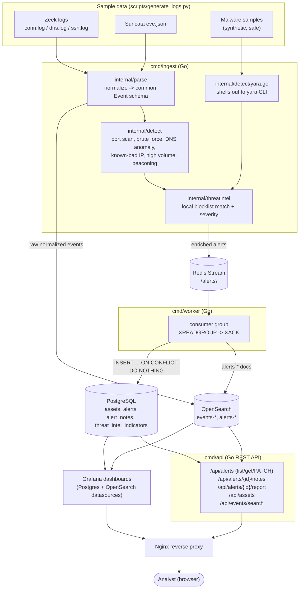

# Architecture

## Why this shape

- **Ingest is a batch job, not a live tail.** The project uses pre-generated,
  realistic Zeek/Suricata sample logs (see the README's "Why sample data, not
  live capture" section) rather than running Zeek/Suricata containers
  against PCAPs. `cmd/ingest` reads the full batch, sorts every event into
  one global chronological stream, and runs the detection engine over it —
  this keeps sliding-window detection correct even though the whole day of
  traffic replays in seconds, because every detector scores its Redis
  windows by the *event's own timestamp*, never wall-clock time.
- **Redis Streams decouple detection from persistence.** `cmd/ingest`
  publishes alerts; `cmd/worker` consumes them independently via a consumer
  group. This is the same shape a live pipeline would use (ingest/detection
  as one scaling tier, persistence as another), just replacing Kafka/RabbitMQ
  with a lighter primitive appropriate for a single-node demo.
- **OpenSearch is the search/log-storage tier; PostgreSQL is the workflow
  system of record.** Alerts are written to both — OpenSearch so Grafana and
  `/api/events/search` can query/search freely, PostgreSQL so the analyst
  triage workflow (status transitions, notes) has transactional
  read-your-writes semantics that a search index doesn't give you.
- **Grafana dashboards are built primarily against PostgreSQL**, not
  hand-written OpenSearch aggregation DSL. Every field the six required
  dashboard views need (alerts over time, top suspicious IPs, affected
  hosts, alert types, severity breakdown, threat intel matches) already
  lives on the `alerts` table, and plain SQL is far more reliable to author
  and review than Grafana's Elasticsearch/OpenSearch query-editor JSON
  format. OpenSearch is still fully wired up and used — for raw event
  storage, `/api/events/search`, and as a second Grafana datasource — see
  `README.md` for the reasoning.
